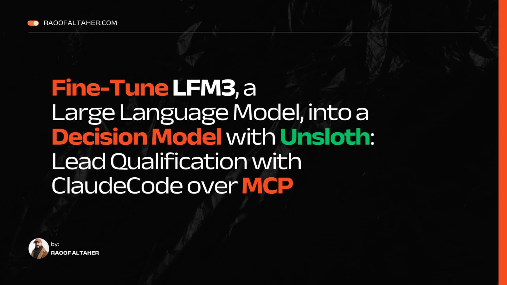

# lead-decision-models

Fine-tuned [Unsloth](https://unsloth.ai/docs/basics/train-your-own-decision-model-with-unsloth) decision models for two decisions in a B2B lead engine:

- **Lead qualification**: does an account fit the example Ideal Customer Profile, and did the lead convert within 90 days in LeadForge's synthetic CRM data?
- **Reply routing**: which of 11 intents does a prospect's reply express, and does it call for a next step?

The models never send a message. Deterministic policy code decides what is allowed, and a person approves every outreach.

## Read the tutorial

<p>
<a href="https://raoofaltaher.com/tutorials/fine-tune-lfm3-decision-model-with-unsloth"></a>
<a href="https://raoofaltaher.com/blog/decision-models-with-unsloth"></a>
</p>

This repository is the companion to the tutorial [Fine-Tune LFM3, a Large Language Model, into a Decision Model with Unsloth: Lead Qualification with Claude Code over MCP](https://raoofaltaher.com/tutorials/fine-tune-lfm3-decision-model-with-unsloth) on raoofaltaher.com. Page 1 trains the lead model, page 2 the reply model, and page 3 connects both to Claude Code. The article [Decision Models: Fine-Tuning LLMs for Structured Decisions](https://raoofaltaher.com/blog/decision-models-with-unsloth) explains decision models in general.

## Contents

| Path | What it holds |
|---|---|
| `notebooks/` | The executed notebooks the tutorial quotes |
| `data/replies/` | The synthetic reply dataset, its card, checksum and check report |
| `integration/` | The policy gate and the serving setup for Claude Code |
| `outputs/` | Metrics, manifests and the recorded case-study session |
| `tools/` | Checks that keep the code, the data and the tutorial consistent |

## The recorded run

| Item | Value |
|---|---|
| GPU | NVIDIA GeForce RTX 5090 Laptop GPU, 24 GB, driver 617.42 |
| System | Ubuntu 24.04.4 LTS on WSL2 (kernel 6.18.54.1) |
| Python | 3.13.18 |
| PyTorch | 2.14.1+cu132 (CUDA runtime 13.2) |
| Unsloth, Unsloth Zoo | 2026.10.11, 2026.10.11 |
| Transformers | 5.22.1 |
| bitsandbytes | 0.50.2 |
| Base model | [`LiquidAI/LFM3-1.7B`](https://huggingface.co/LiquidAI/LFM3-1.7B) at revision `ac2586a34f1a1c03329dbdcdefabd8b6478ddaa7`, 4-bit QLoRA |

| Notebook | Wall time | Training | Peak VRAM | Mean prediction |
|---|---:|---:|---:|---:|
| `01-lead-qualification.ipynb` | 1,917 s | 1,005.0 s | 2.73 GB | 92.1 ms |
| `02-reply-routing.ipynb` | 1,962 s | 207.0 s for the chosen setting, 711.0 s for all four candidates | 4.6 GB | 75.6 ms |

Test results from this one run, beside a simple baseline trained on the same split:

| Model | Metric | Fine-tuned LFM3 | Baseline |
|---|---|---:|---:|
| Lead, ICP fit | Accuracy | 1.000 | |
| Lead, 90-day conversion | ROC-AUC | 0.8692 | 0.8758 (logistic regression) |
| Lead, 90-day conversion | Average precision | 0.5167 | 0.5495 |
| Lead, 90-day conversion | Brier score (lower is better) | 0.1091 | 0.1105 |
| Lead, both questions | ECE (lower is better) | 0.0011 | |
| Reply, 11 intents | Macro-F1 | 0.9746 | 0.7049 (TF-IDF + logistic regression) |
| Reply, 11 intents | Accuracy | 0.976 | 0.710 |
| Reply, both questions | ECE (lower is better) | 0.0191 | |

The fine-tuned lead model ranks conversions slightly below the logistic regression; the reply model beats its baseline by a wide margin. The metrics come from `outputs/lead-metrics.json`, `outputs/reply-metrics.json` and `outputs/experiment-manifest.json`; the wall times from `outputs/logs/final-run-times.txt` (kept out of git) and the notebooks' timing cells; the TF-IDF accuracy from `outputs/reply-test-predictions.csv`. `outputs/figures/` holds the plots of both notebooks, and `outputs/reply-metrics-first-version.json` holds the metrics of the earlier 20-step reply run.

The reply notebook chooses its training setting on validation data: it trains 3 or 6 epochs at LoRA rank 16 or 64 (batch 8, no accumulation), picks the best validation macro-F1 (6 epochs, rank 64: 0.945), and scores the test set once. The same notebook ran twice with seed 3407; the first run stopped in a cleanup cell after it scored the test set at 0.924, and the recorded second run scored 0.975. GPU kernels are not fully deterministic, so expect a spread of that size on 124 test replies.

To see how much one run says, the lead model was trained three more times with training seeds 1, 2 and 3 on the same splits (`tools/seed_study.py`; the notebooks and metrics are in `outputs/seed-study/`, the summary in `outputs/seed-study.json`). Over the four runs:

| Lead, 90-day conversion | Mean | Range | Logistic regression |
|---|---:|---:|---:|
| ROC-AUC | 0.871 | 0.869 to 0.874 | 0.876 |
| Average precision | 0.531 | 0.517 to 0.548 | 0.550 |
| Brier score (lower is better) | 0.1092 | 0.1087 to 0.1099 | 0.1105 |
| Precision at 100 | 0.53 | 0.51 to 0.55 | 0.54 |

By ROC-AUC and average precision, every run ranks conversions slightly below the logistic regression, and every run has a slightly lower Brier score. Precision at 100 moves around the baseline's 0.54.

The models are on the Hugging Face Hub: [lead qualifier](https://huggingface.co/raoofaltaher/lead-decision-models-lead-qualifier) ([merged](https://huggingface.co/raoofaltaher/lead-decision-models-lead-qualifier-merged)) and [reply router](https://huggingface.co/raoofaltaher/lead-decision-models-reply-router) ([merged](https://huggingface.co/raoofaltaher/lead-decision-models-reply-router-merged)). `outputs/hub-check.json` shows that each Hub copy holds the files of this run and predicts the same classes.

## Run it

```bash
curl -LsSf https://astral.sh/uv/install.sh | sh
git clone https://github.com/raoofaltaher/lead-decision-models
cd lead-decision-models
uv venv unsloth_env --python 3.13
source unsloth_env/bin/activate
uv pip sync --torch-backend=auto requirements-experiment.txt
python tools/check_unsloth_pin.py --commit 53eeebdc9be3c3e1a27f891b668a38df0e1abb88
```

`--torch-backend=auto` picks the CUDA 13.2 build of PyTorch on a driver that supports it. To install the same files on any driver, replace the sync line with `uv pip sync --index-url https://pypi.org/simple --extra-index-url https://download.pytorch.org/whl/cu132 --index-strategy unsafe-best-match requirements-experiment.txt`.

`uv pip check` reports four notes, and all four are deliberate: Transformers 5.22.1 and datasets 5.1.0 are above the ranges that Unsloth 2026.10.11 declares. LFM3's own code needs Transformers 5.22.1 (`outputs/lfm3-probe-*.json` records the releases that fail), and datasets 5.1.0 with fsspec 2026.7.0 close two security advisories.

Set `HF_USERNAME` to your Hugging Face account in the first cell of each notebook, or set `PUBLISH = False` to skip the upload. To publish, log in once with a write token (`hf auth login`). Then run the notebooks in order:

```bash
jupyter nbconvert --to notebook --execute --inplace --ExecutePreprocessor.timeout=-1 notebooks/01-lead-qualification.ipynb
jupyter nbconvert --to notebook --execute --inplace --ExecutePreprocessor.timeout=-1 notebooks/02-reply-routing.ipynb
python -m pytest -q
```

`integration/README.md` connects the trained models to Claude Code.

## License

MIT for the code and the reply dataset in this repository. The base model `LiquidAI/LFM3-1.7B` is under the LFM Open License v1.0, and so are the four fine-tuned models on the Hub: commercial use is licensed only below the revenue threshold that license defines. LeadForge data is MIT and is downloaded at run time, not redistributed.
