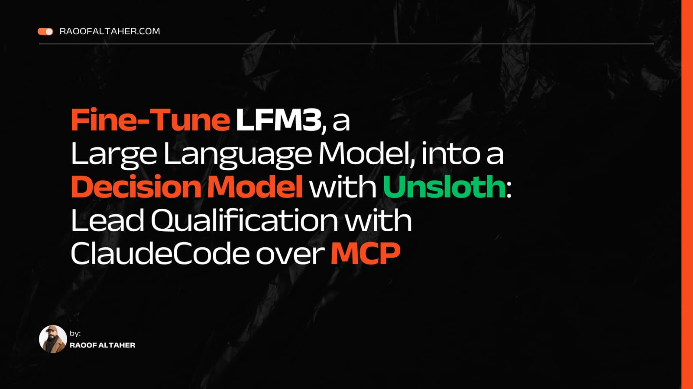

# lead-decision-models-lead-qualifier-merged

A decision model (lead qualifier) fine-tuned from `LiquidAI/LFM3-1.7B` (revision `ac2586a34f1a1c03329dbdcdefabd8b6478ddaa7`) with Unsloth's `FastDecisionModel` and a Clef decision head. It scores the options it is given and returns probabilities; it never generates text and never sends a message.

## Read the tutorial

<p>
<a href="https://raoofaltaher.com/tutorials/fine-tune-lfm3-decision-model-with-unsloth"></a>
<a href="https://raoofaltaher.com/blog/decision-models-with-unsloth"></a>
</p>

The tutorial [Fine-Tune LFM3, a Large Language Model, into a Decision Model with Unsloth: Lead Qualification with Claude Code over MCP](https://raoofaltaher.com/tutorials/fine-tune-lfm3-decision-model-with-unsloth) trains and uses this model step by step, and the article [Decision Models: Fine-Tuning LLMs for Structured Decisions](https://raoofaltaher.com/blog/decision-models-with-unsloth) explains decision models. Both are on raoofaltaher.com.

## Intended use

Scores a B2B lead record against an example Ideal Customer Profile (fit, not_fit, insufficient_evidence) and classifies LeadForge's 90-day conversion label. It is a teaching model from the tutorial at https://raoofaltaher.com/tutorials/fine-tune-lfm3-decision-model-with-unsloth. Deterministic policy code and a person must decide every outreach action; a model probability is not permission to contact anyone.

## Training data

The intermediate tier of the LeadForge synthetic CRM release v0.1.0-alpha (MIT), split by account so no company appears in two partitions.

| Partition | Rows |
|---|---:|
| optimizer_training | 2400 |
| calibration | 598 |
| validation | 1000 |
| test | 1002 |

## Test metrics from the recorded run

| Metric | This model | Logistic regression |
|---|---:|---:|
| accuracy | 0.8932 | — |
| ece | 0.0011 | — |
| loss | 0.1562 | — |
| record_accuracy | 0.7864 | — |
| roc_auc | 0.8692 | 0.8758 |
| average_precision | 0.5167 | 0.5495 |
| brier | 0.1091 | 0.1105 |
| precision_at_100 | 0.5100 | 0.5400 |

`accuracy`, `ece`, `loss` and `record_accuracy` cover both questions; `roc_auc`, `average_precision`, `brier` and `precision_at_100` score the 90-day conversion question only. Lower is better for `ece`, `loss` and `brier`; higher is better for the others. The baseline column comes from the same run, the same split and the same features.

Peak training VRAM: 2.73 GB.

## Links

- Companion repository with the notebook, the data, the plots and the tests: https://github.com/raoofaltaher/lead-decision-models
- The adapter and decision head of the same run: [raoofaltaher/lead-decision-models-lead-qualifier](https://huggingface.co/raoofaltaher/lead-decision-models-lead-qualifier)
- The tutorial that trains and uses it: https://raoofaltaher.com/tutorials/fine-tune-lfm3-decision-model-with-unsloth

## How to load

```python
from unsloth import FastDecisionModel

model, tokenizer = FastDecisionModel.from_pretrained("raoofaltaher/lead-decision-models-lead-qualifier-merged", trust_remote_code=True, load_in_4bit=True)
FastDecisionModel.for_inference(model)
```

`LiquidAI/LFM3-1.7B` ships custom modeling code, so loading needs `trust_remote_code=True`. Read the Python files of `LiquidAI/LFM3-1.7B` at revision `ac2586a34f1a1c03329dbdcdefabd8b6478ddaa7` before you run it; the merged repository carries copies of them.

## Limitations

The training data is synthetic. These metrics show that the pipeline works; they do not show performance on real CRM records or real sales replies. Probabilities and calibration can shift when the market, the data source or the process changes.

LFM3-1.7B is released under the LFM Open License v1.0. Commercial use of the model and of derivatives such as this one is licensed only below the revenue threshold that license defines; read it before any commercial use.
