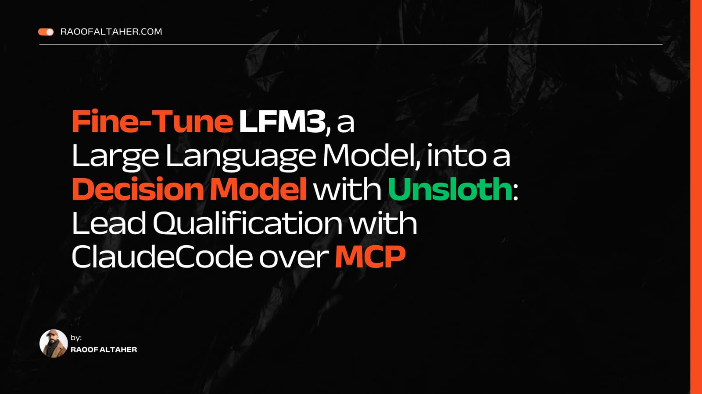
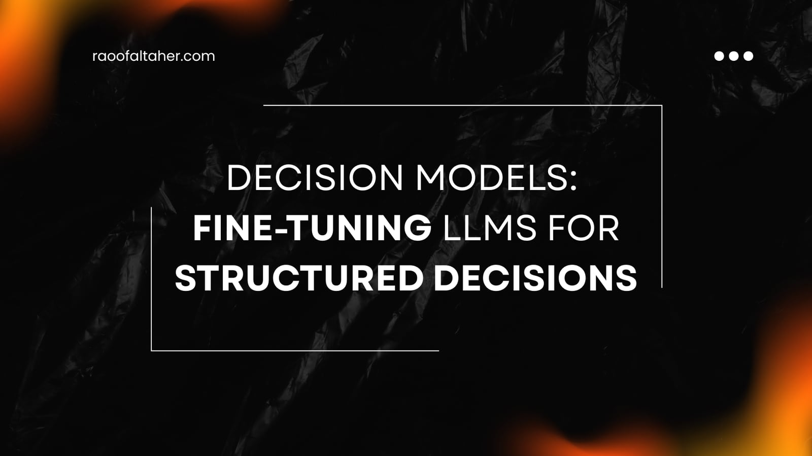

# lead-decision-models-reply-router-merged

A decision model (reply router) fine-tuned from `LiquidAI/LFM3-1.7B` (revision `ac2586a34f1a1c03329dbdcdefabd8b6478ddaa7`) with Unsloth's `FastDecisionModel` and a Clef decision head. It scores the options it is given and returns probabilities; it never generates text and never sends a message.

## Read the tutorial

<p>
<a href="https://raoofaltaher.com/tutorials/fine-tune-lfm3-decision-model-with-unsloth/reply-routing"></a>
<a href="https://raoofaltaher.com/blog/decision-models-with-unsloth"></a>
</p>

The tutorial [Fine-Tune LFM3, a Large Language Model, into a Decision Model with Unsloth: Lead Qualification with Claude Code over MCP](https://raoofaltaher.com/tutorials/fine-tune-lfm3-decision-model-with-unsloth/reply-routing) trains and uses this model step by step, and the article [Decision Models: Fine-Tuning LLMs for Structured Decisions](https://raoofaltaher.com/blog/decision-models-with-unsloth) explains decision models. Both are on raoofaltaher.com.

## Intended use

Classifies a prospect's reply to a first-touch sales email into one of 11 intents and predicts whether a next step is called for. It is a teaching model from the tutorial at https://raoofaltaher.com/tutorials/fine-tune-lfm3-decision-model-with-unsloth/reply-routing. Deterministic policy code and a person must decide every outreach action; a model probability is not permission to contact anyone.

## Training data

617 LLM-generated synthetic replies, checked automatically with a blind relabel and not reviewed by a person (see data/replies/DATASET_CARD.md in the companion repository).

| Partition | Rows |
|---|---:|
| optimizer_training | 296 |
| calibration | 73 |
| validation | 124 |
| test | 124 |

## Test metrics from the recorded run

| Metric | This model | TF-IDF + logistic regression |
|---|---:|---:|
| accuracy | 0.9758 | — |
| ece | 0.0191 | — |
| loss | 0.0905 | — |
| record_accuracy | 0.9597 | — |
| macro_f1 | 0.9746 | 0.7049 |

`accuracy`, `ece`, `loss` and `record_accuracy` cover both questions; `macro_f1` scores the 11-intent question only. Lower is better for `ece`, `loss` and `brier`; higher is better for the others. The baseline column comes from the same run, the same split and the same features.

Peak training VRAM: 4.6 GB.

## Links

- Companion repository with the notebook, the data, the plots and the tests: https://github.com/raoofaltaher/lead-decision-models
- The adapter and decision head of the same run: [raoofaltaher/lead-decision-models-reply-router](https://huggingface.co/raoofaltaher/lead-decision-models-reply-router)
- The tutorial that trains and uses it: https://raoofaltaher.com/tutorials/fine-tune-lfm3-decision-model-with-unsloth/reply-routing

## How to load

```python
from unsloth import FastDecisionModel

model, tokenizer = FastDecisionModel.from_pretrained("raoofaltaher/lead-decision-models-reply-router-merged", trust_remote_code=True, load_in_4bit=True)
FastDecisionModel.for_inference(model)
```

`LiquidAI/LFM3-1.7B` ships custom modeling code, so loading needs `trust_remote_code=True`. Read the Python files of `LiquidAI/LFM3-1.7B` at revision `ac2586a34f1a1c03329dbdcdefabd8b6478ddaa7` before you run it; the merged repository carries copies of them.

## Limitations

The training data is synthetic. These metrics show that the pipeline works; they do not show performance on real CRM records or real sales replies. Probabilities and calibration can shift when the market, the data source or the process changes.

LFM3-1.7B is released under the LFM Open License v1.0. Commercial use of the model and of derivatives such as this one is licensed only below the revenue threshold that license defines; read it before any commercial use.
